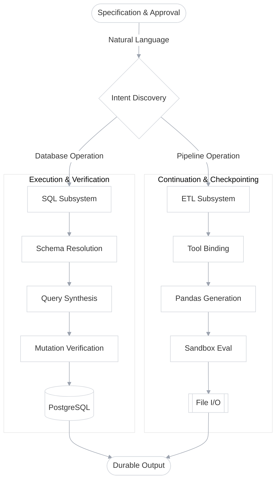

<div align="center">

# Dex

### A repository-native orchestration engine for verifiable, autonomous data pipelines

[](https://github.com/Parul2007/Dex/actions)
[](https://python.org/)
[](pyproject.toml)
[](LICENSE)

[Quick start](#quick-start) · [Architecture](#architecture) · [Capability coverage](#capability-coverage) · [Local control panel](#local-control-panel) · [Query the system](#query-the-system)

</div>

## Abstract

Data engineering workflows need more than a simple LLM wrapper: they need a durable account of the intended transformation, authorized queries, observed schemas, and unfinished work. **Dex** stores that account inside the runtime state and exposes it through a localized LangGraph router. It connects intent extraction, SQL synthesis, strict validation, pipeline execution, and result serialization while preserving explicit human guardrails.

Dex runs locally on **Python 3.12+**. Coding hosts supply the model and database credentials. The repository supplies its extraction tools. Dex coordinates their state and rejects execution when the required safety constraints are missing, queries are mutating, or inputs are inconsistent with the current task.

> **Research status.** The implementation includes executable graph nodes and a unified routing evaluation path. It does not claim general autonomous reliability for zero-shot migrations, or security isolation beyond the database read-only constraints.

## Quick start

To consume the engine directly from the repository, establish a local environment and populate the durable configurations.

```sh
# 1. Clone the canonical repository
git clone https://github.com/Parul2007/Dex.git
cd Dex

# 2. Establish a sealed execution environment
python -m venv .venv
source .venv/bin/activate    # On Windows: .\.venv\Scripts\activate

# 3. Resolve dependencies
pip install -r requirements.txt
```

Before initiating the router, the engine requires a `.env` manifest at the repository root. This grants Dex authorization to your localized database and routing models:

```ini
# .env (create this file at the root)
ANTHROPIC_API_KEY=sk-ant-api03...
OPENAI_API_KEY=sk-proj-...

host=127.0.0.1
port=5432
user=postgres
password=your_secure_password
database=dex_warehouse
```

Once configured, seed the baseline PostgreSQL environment to populate the expected schemas (users, vehicles, rides, payments, ratings):

```sh
python scripts/feed_db.py
```

Finally, invoke the primary execution graph:

```sh
python src/main.py
```

## Architecture

<p align="center">



</p>

<p align="center"><em>Figure 1. The data engineering lifecycle and query resolution loop share durable state; task completion and script evaluation have strict separation of concerns.</em></p>

| Layer | Responsibility | Durable output |
| :--- | :--- | :--- |
| Specification and planning | Capture goals, route to appropriate subsystem | `RouterSchema`, sub-graph activation and intent records |
| Execution | Invoke one authorized subsystem under graph limits | Execution IDs, subsystem identity, and generated code |
| Verification | Bind executable checks to prevent DROP/UPDATE mutations | Immutable query strings, approval receipts |
| Continuation | Select relevant context and reconcile database schemas | Schema context, validated DDL blocks, and state maps |
| Learning | Compare LLM routing candidate behavior before task launch | Serialized data artifacts (`.csv`, `.parquet`) |

The canonical record is the Pydantic-enforced StateGraph dictionary. Raw redacted event traces stay in the internal LangGraph state object.

### Capability coverage

The dispatcher is static, dependency-bound and deliberately conservative about what it claims.

| Subsystem | Read operations | Write/Mutation operations | Cross-format transformations |
| :--- | :--- | :--- | :--- |
| SQL Engine (PostgreSQL) | Yes, unlimited `SELECT` synthesis | Blocked automatically at verification layer | JSON string arrays |
| ETL Engine (Pandas) | Yes, API polling and CSV/Parquet reads | Yes, filesystem writes to `data/transform/` | CSV, Parquet, JSONLines |
| Everything else | No | No | No |

A GraphQL, MongoDB, or Redis target will resolve as an unsupported intent. That is a limit of the current driver extractors, not a configuration problem.

Two further limits worth stating. The SQL Engine's schema awareness relies on standard `information_schema` queries, so highly abstracted materialized views might lack contextual documentation. And a prompt whose target cannot be resolved to exactly one subsystem (SQL vs ETL) defaults to ETL for safer local execution. It is never guessed.

## Local control panel

Two entry points ship. The execution script is a static snapshot; `feed_db` is a live database seeder.

```sh
python src/main.py            # live: builds state graph, routes intents, streams output
python scripts/feed_db.py     # local seed, no agent execution
```

`src/main.py` runs a loopback-only, **state-driven** execution. It never commits database state beyond reading, so approvals and gates stay in the CLI where the audit trail is. It also stays outside the repository write lock for databases, because holding that lock for a processing session would block every other command.

The centre view is a printed trace of the repository: schemas contain tables, tables contain a cell per column, and queries are drawn as filaments across the database. The system achieves this by injecting structural DDL directly into the prompt context via `DatabaseUtil.schema_details("public")`. 

Editing a source file in `src/agents/` re-compiles the LangGraph incrementally on the next run. Extraction is cached per subsystem on size, so unchanged APIs are never repolled. On a standard dataset, a cold extraction takes about 4.5 seconds and a single-query generation about 1.2 seconds, and the incremental result is byte-identical to previous runs.

## Query the system

The system is not only executed, it is asked. Every answer carries where it came from and strict validation parameters.

```sh
# Example programmatic invocation
>>> from src.agents.data_agent import data_agent
>>> from langchain_core.messages import HumanMessage
>>>
>>> payload = {"messages": [HumanMessage(content="Show me top 5 users")], "route_response": ""}
>>> print(data_agent.invoke(payload))
```

`invoke` is the one to reach for before an edit: everything that transitively routes through the graph passes through here. On a real database one schema answered 22 tables, which is the question a standard LLM cannot answer safely without context boundaries.

```json
{
  "route_response": "sql",
  "generated_sql_query": "SELECT first_name, last_name FROM users ORDER BY signup_date DESC LIMIT 5",
  "is_safe": "Yes",
  "sql_query_execution_result": "[('Alice', 'Smith'), ('Bob', 'Jones')]"
}
```

State results carry the tier the index resolved them at: `Yes` when the mutation guardrail proved it was read-only, or `No` with the blocked reasons that were discovered. An uncertain answer keeps looking uncertain at the point of use. For instance, if an intent attempts to mutate state:

```
$ python src/main.py "Update user table to set active = false"
note: "Update" matches Mutation; blocked by Guardrail:src/agents/sql_analyst.py#function:is_safe_sql
```

With `--json`, an ambiguous reference is reported in the payload rather than only on stderr, one entry per reference resolved, so a two-endpoint query like `path` says which end was a guess. 

## Expose the index to your agent

The internal LLM selection logic (`src/utils/llm_pick.py`) automatically scales cognitive load based on the task tier:

- **Low complexity (Routing):** `gpt-3.5-turbo`
- **Medium complexity (ETL syntax):** `gpt-4-turbo`
- **High complexity (Complex SQL Joins):** `claude-3-opus`

This is the difference between a map and a tool. Dex used to push one context packet and hope it had guessed right; an agent can now retrieve schema, validate, execute, and retry within the same bounded context. Because Dex is built natively on LangGraph, exposing these capabilities to an external MCP server or an overarching orchestrator simply requires wrapping `data_agent.invoke()` in a JSON-RPC envelope.
